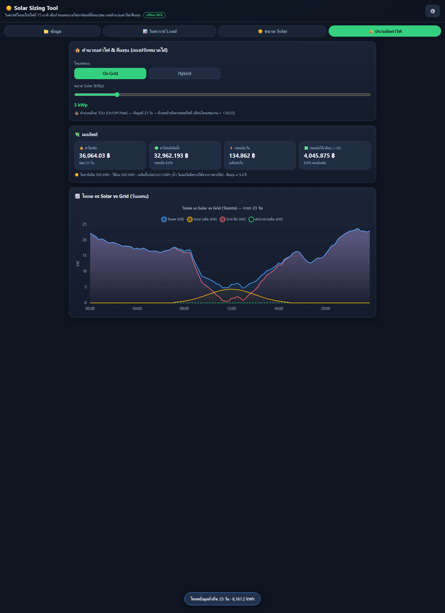
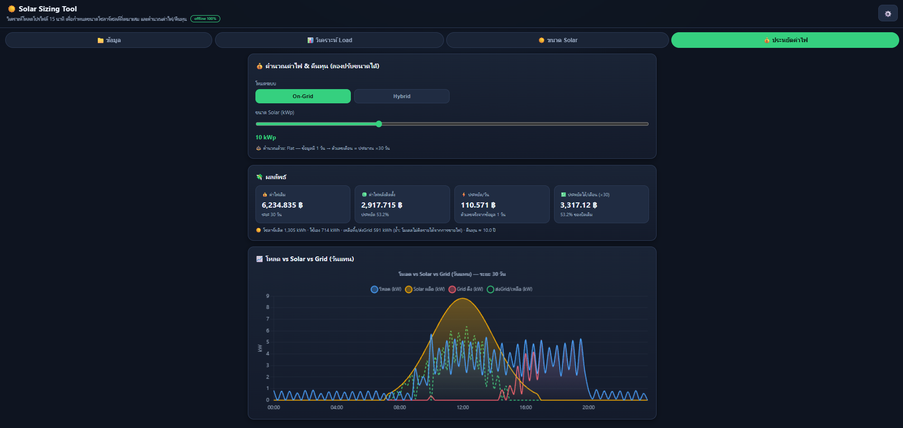
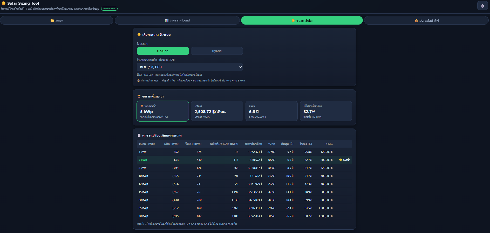
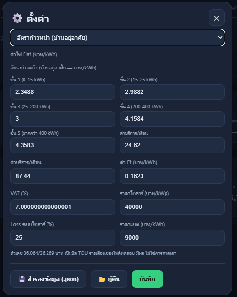

# ☀️ Solar Sizing Tool (Offline Web)

แอปคำนวณขนาดโซล่าเซลล์จากไฟล์ข้อมูลมิเตอร์ — **ใช้งานแบบออฟไลน์ 100%** ไม่ต้องต่อเน็ต ไม่ต้องลง Python
เปิดไฟล์ `index.html` แล้วใช้งานได้เลย (double-click เพื่อเปิดในเบราว์เซอร์ Chrome / Edge / ธรรมดาได้ทุกตัว)

> ### 🔗 ใช้งานออนไลน์ — ไม่ต้องติดตั้งอะไร
> **https://icem79ai-ops.github.io/Solar-Sizing-Tool/**
>
> ใครมีลิงก์ก็เปิดใช้ได้ทันทีบนเบราว์เซอร์ (มือถือ/แท็บเล็ต/คอม)
> การเปิดให้ใช้ผ่านเว็บ **ไม่ได้** ให้สิทธิ์คัดลอกโค้ด — ดู [`LICENSE`](LICENSE)



เลขที่คำนวณ **ตรงกับเวอร์ชัน Python (Streamlit)** ที่ผ่านการตรวจสอบแล้ว

### 📷 ภาพหน้าจอ

| 📊 วิเคราะห์ Load | ☀️ ขนาด Solar |
|---|---|
|  |  |

**⚙️ ตั้งค่า — เลือกแบบอัตราค่าไฟของกฟภ. (TOU / ก้าวหน้า 5 ขั้น / 3 ขั้น / Flat) พร้อมแก้เลขเองได้**




---

## 🎨 สไตล์กราฟ (Load Profile Style)

กราฟเส้นใช้ธีมมืดตามสูตร `CHART_STYLE_SPEC.md` — ไล่โทนสีใต้เส้น (Gradient) แนวตั้งจากเข้ม→จาง, เส้นโค้งนุ่ม (tension), ไม่มีจุดเกะกะ (จุด Tooltip ใหญ่เพื่อแตะง่ายบนมือถือ), Tooltip พื้นมืด, แกนนอนแสดงเวลาหลักทุก 4 ชั่วโมง, แกนตั้งเริ่มที่ 0 — แบบเดียวกับ Load Profile Generator

---

## 🚀 วิธีใช้

1. เปิดโฟลเดอร์นี้ แล้ว **double-click `index.html`**
2. ไปแท็บ **📁 ข้อมูล** → เลือกไฟล์ข้อมูลมิเตอร์:

   | ประเภทไฟล์ | วิธีเลือก |
   |---|---|
   | **ไฟล์ .xls (HTML)** | **ต้องเลือก 2 ไฟล์พร้อมกัน** คือ ไฟล์ `.xls` (โครง frameset) **และ** ไฟล์ `sheet001.htm` ในโฟลเดอร์ย่อย `ชื่อไฟล์_files/` (กด Ctrl/Shift ค้างเพื่อเลือกหลายไฟล์ หรือลากวางใส่กล่อง) |
   | **ไฟล์บ้าน/ทั่วไป (.xlsx / .csv)** | เลือกไฟล์เดียว เช่น `_ A_load_profile.xlsx`, `HB_load_profile.xlsx` |

3. ดูผลลัพธ์ตามแท็บ:
   - **📊 วิเคราะห์ Load** — ค่าไฟจริงของช่วงข้อมูล (แยก On/Off-Peak ตามไฟล์), พลังงานรวม, Peak, กราฟโหลดเฉลี่ย/วัน — **เลือกอัตราค่าไฟได้จาก dropdown ในหน้านี้เลย** (TOU / ก้าวหน้า 5 ขั้น / ก้าวหน้า 3 ขั้น / Flat)
   - **☀️ ขนาด Solar** — ตารางเปรียบเทียบขนาด 3–30 kWp (ประหยัด/เดือน, คืนทุน, % ใช้เอง) + ขนาดแนะนำ ⭐ + กราฟ พร้อมโหมด **Hybrid** (โซลาร์ + แบตเตอรี่)
   - **💰 ประหยัดค่าไฟ** — ถามโจทย์ว่า "ถ้าติด X kWp → ประหยัดเท่าไหร่" แบบ On-Grid หรือ Hybrid พร้อมกราฟโหลด/Solar/Grid/แบต + SoC
   - กด **ตั้งค่า** (⚙️) เพื่อปรับอัตราค่าไฟ TOU/โปรเกรสซีฟ/Flat ค่า FT ค่าบริการ VAT ราคาโซลาร์-แบต Loss ฯลฯ
   - กด **ส่งออก** เพื่อดาวน์โหลดผลเป็น `.xlsx` หรือ `.csv`

---

## 📐 เกณฑ์การคำนวณ (เหมือน Python)

- **อัตรา TOU**: On-Peak 5.7982 / Off-Peak 2.6369 / ค่า Ft 0.1623 / ค่าบริการ 87.44 / VAT 7%
- **อัตราก้าวหน้า 5 ขั้น (1.1.1)**: 0–15:2.3488, 15–25:2.9882, 25–200:3.0, 200–400:4.1584, >400:4.3583 (ค่าบริการ 8.19)
- **อัตราก้าวหน้า 3 ขั้น (1.1.2)**: 0–200:3.0, 200–400:4.1584, >400:4.3583 (ค่าบริการ 24.62)
- **เลือกอัตราได้ 3 ที่**: dropdown บนแท็บ *วิเคราะห์ Load* (เห็นผลทันที), ในหน้าตั้งค่า และติดป้ายในทุกแท็บว่าใช้เลขชุดไหน
- **อัตโนมัติ = อ่านช่อง `Tariff:` ในไฟล์ PEA** → `TOU`/`3.x` = TOU, `1.1.1` = ก้าวหน้า 5 ขั้น, `1.1.2` = ก้าวหน้า 3 ขั้น (ไฟล์ที่ไม่มีช่องนี้ใช้ TOU เป็นค่าเริ่มต้น)
- **ขั้นอัตราก้าวหน้าคิดบนหน่วยต่อเดือน** — ไฟล์ 10 วันจะถูกขยายเป็น 30 วันก่อนคิดขั้น แล้วเทียบกลับเป็นตัวเลขของช่วงไฟล์ (บิลจริงของการไฟฟ้าเป็นรายเดือน ถ้าคิดขั้นบนหน่วย 10 วันจะต่ำเกินจริง)
- แก้ตัวเลขเองได้ทุกช่อง (ขั้นอัตรา/ค่าบริการ) — ระบบจะเปลี่ยนสถานะเป็น "กำหนดเอง" และคงค่าที่แก้ไว้
- เลือกอัตราที่ต้องการค้างไว้เพื่อใช้ซ้ำ (บันทึกลง localStorage; ค่าเก่ายังโหลดได้)
- **โหลดเต็ม "Peak Sun Hours (PSH)" รายเดือน (จังหวัดตรัง)**: ม.ค. 6.5, ก.พ. 6.8, มี.ค. 6.5, เม.ย. 5.8, พ.ค. 5.0, มิ.ย. 4.5, ก.ค. 4.2, ส.ค. 4.3, ก.ย. 4.8, ต.ค. 5.2, พ.ย. 5.8, ธ.ค. 6.0
- **System Loss 25%**, ราคาโซลาร์ 40,000 บาท/kWp
- **รูปแบบทางคณิตศาสตร์**: เส้นการผลิตโซลาร์เป็นกราฟระฆัง (Gaussian) ประจำวัน 06:45–17:15 พื้นที่รวม = PSH
- **ขนาดแนะนำ**: ไล่ขนาด 3/5/8/10/12/15/20/25/30 kWp → ตัดขนาดที่คืนทุน ≤ 10 ปี + % ใช้ไฟเอง (Self-CR) ≥ 50% → เลือกที่ประหยัดสูงสุดโดย ROI ≥ 70% ของขนาดดีที่สุด
- **แบตเตอรี่แนะนำ (Hybrid)**: ไล่ความจุ 5–100 kWh คัดที่เพิ่มประหยัด ≥ 50 บาท/เดือน และคืนทุนแบต ≤ 10 ปี
- ⚠️ **โมเดลไม่คิดรายได้จากการขายไฟ (Net Metering)** — นับเพียงไฟที่ใช้เอง สว.จาการีเทิร์น ตัวเลขจึงอนุรักษ์นิยม

### ตัวเลขที่ตรวจสอบแล้ว (เทียบ Python เป๊ะ)

| รายการ | ค่า |
|---|---|
| ไฟล์มิเตอร์ 23 วัน | พลังงานรวม 8,167.2 kWh · Peak 48.48 kW |
| ค่าไฟวิเคราะห์ (แยก On/Off ตามไฟล์) | 36,268.74 บาท |
| ค่าไฟอ้างอิงคิดขนาด (หน้าต่าง 09:00–22:00) | 36,064.03 บาท |
| ขนาดแนะนำ On-Grid | **12 kWp** |
| ประหยัด 12 kWp | 7,246 บาท/เดือน (5,555.8 / 23 วัน) |
| ประหยัด 10 kWp | 6,645 บาท/เดือน (5,094.2 / 23 วัน) |
| Hybrid 10 kWp + 15 kWh | 7,968 บาท/เดือน (6,108.9 / 23 วัน) |
| แบตแนะนำ (ที่ 12 kWp) | **15 kWh** |
| ไฟล์บ้าน 1 วัน | 79.9 kWh / Peak 7.39 → แนะนำ 3 kWp |

### ค่าไฟเดิมของไฟล์ตัวอย่าง 23 วัน (8,167 kWh) — เทียบแต่ละอัตรา

| อัตรา | ระยะ 23 วัน | ต่อเดือน (×30/23) |
|---|---|---|
| TOU (ไฟล์นี้ระบุ Tariff: TOU) | 36,269 | 47,307 |
| ก้าวหน้า 5 ขั้น (1.1.1) | 39,248 | 51,193 |
| ก้าวหน้า 3 ขั้น (1.1.2) | 39,270 | 51,221 |
| Flat 4.18 | 38,040 | 49,618 |

> ค่าไฟบ้านอยู่อาศัยที่ใช้ TOU ของธุรกิจจะได้เลขต่ำกว่าจริงหลายพันบาท/เดือน — จึงต้องเลือกอัตราให้ตรงกับบิล

---

## 🧪 การทดสอบ (สำหรับนักพัฒนา)

```powershell
node __tests__\test_core.js     # 49 การทดสอบ เทียบเลข Python + preset + ขั้นรายเดือน
```

และ E2E ผ่านเบราว์เซอร์จริง: เปิด `__tests__\e2e.html` (ในโฟลเดอร์นี้) จะโหลดแอปใน iframe โหลดไฟล์มิเตอร์จริง แล้วตรวจค่า

---

## 📂 โครงสร้าง

```
Solar-Sizing-Tool/
├── index.html        # หน้าแอป (เปิดได้เลย)
├── style.css         # สไตล์ (มือถือ/เดสก์ท็อป)
├── core.js           # เอนจินคำนวณล้วน (JS) — โมเดลเดียวกับ Python
├── app.js            # UI + กราฟ + ส่งออกไฟล์
├── lib/
│   ├── chart.umd.min.js   # Chart.js v4.4.3 (ในเครื่อง)
│   └── xlsx.full.min.js   # SheetJS 0.20.2 (ในเครื่อง)
├── __tests__/        # เทสต์ Node + E2E
├── LICENSE           # สัญญาอนุญาตใช้งาน (สงวนลิขสิทธิ์)
├── THIRD-PARTY-NOTICES.md  # แจ้งลิขสิทธิ์ไลบรารีบุคคลที่สาม
└── licenses/         # สำเนาสัญญาอนุญาตฉบับเต็ม (Chart.js MIT, SheetJS Apache-2.0)
```

- ไม่มีการเรียก CDN/URL ภายนอก — ทุกไลบรารีอัดไว้ในโฟลเดอร์แล้ว → นำไปใช้งานที่ออฟฟิศได้เลยแม้ไม่มีอินเทอร์เน็ต
- การตั้งค่าจะบันทึกในเบราว์เซอร์ (localStorage) — จัดการได้ผ่านปุ่ม **สำรอง (Backup)** / **กู้คืน (Restore)** ในหน้าการตั้งค่า

---

## ©️ ลิขสิทธิ์ (Copyright)

ลิขสิทธิ์ © 2569 (2026) **icem79ai-ops** — สงวนลิขสิทธิ์

| อนุญาต | ห้าม |
|---|---|
| เปิดใช้งานผ่านเว็บสำหรับผู้ที่ได้รับลิงก์ | คัดลอก ทำซ้ำ หรือเผยแพร่ซอร์สโค้ด |
| ใช้ในงานของตนเอง / งานส่วนตัว | ดัดแปลง แก้ไข หรือสร้างงานดัดแปลง |
| | จำหน่าย ให้เช่า หรือใช้บนผลิตภัณฑ์/บริการที่เรียกเก็บเงิน |
| | ลบหรือปกปิดข้อความลิขสิทธิ์ |

- โค้ดของโครงการ: [`LICENSE`](LICENSE)
- ไลบรารีบุคคลที่สาม: [`THIRD-PARTY-NOTICES.md`](THIRD-PARTY-NOTICES.md)
  — Chart.js v4.4.3 (MIT), SheetJS v0.20.2 (Apache-2.0)
- ลิขสิทธิ์เกิดขึ้นโดยอัตโนมัติเมื่อสร้างงาน ตามพระราชบัญญัติลิขสิทธิ์ พ.ศ. 2537
  ไม่ต้องจดทะเบียน (การจดแจ้งข้อมูลลิขสิทธิ์กับกรมทรัพย์สินทางปัญญาเป็นเพียงหลักฐานประกอบ)

**ข้อจำกัดทางเทคนิคที่ควรรู้:** แอปนี้ทำงานฝั่งเบราว์เซอร์ทั้งหมด (static site)
ดังนั้นผู้ที่เปิดหน้าเว็บย่อมสามารถอ่านไฟล์ JavaScript ที่ส่งไปให้เบราว์เซอร์ได้
ลิขสิทธิ์จึงคุ้มครองได้ทางกฎหมาย แต่ไม่ได้ซ่อนโค้ด — หากต้องการป้องกันเชิงเทคนิค
ต้องย้ายตรรกะการคำนวณ (`core.js`) ไปทำงานฝั่งเซิร์ฟเวอร์

---

## ℹ️ หมายเหตุ

- ไฟล์ .xls ทั่วไป (`สินค้าเป็น HTML แม้ชื่อ .xls`) — จำเป็นต้องเลือก `sheet001.htm` ด้วยเสมอ ถ้าเลือกผิดแอปจะแจ้งเตือน
- ถ้าข้อมูลมี 1 วัน แอปจะประมาณค่าใช้ไฟเต็มเดือน = ×30 วัน และแจ้งไว้บนหน้า
- ตัวเลขทั้งหมดใช้หน่วยบาทไทย และคืนทุนเป็นปี
- แหล่งที่มา (GitHub): <https://github.com/icem79ai-ops/Solar-Sizing-Tool>
- เว็บที่ให้บริการ: <https://icem79ai-ops.github.io/Solar-Sizing-Tool/>